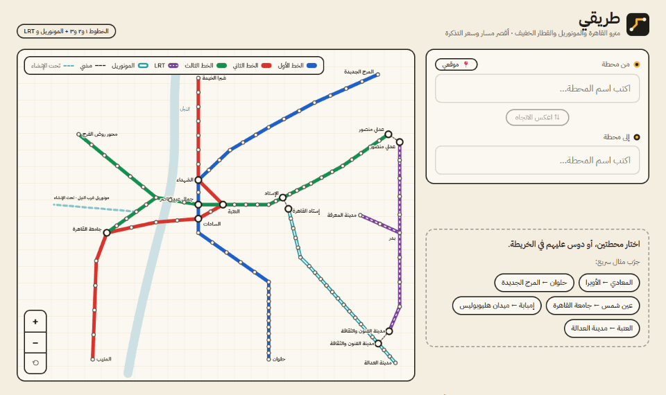
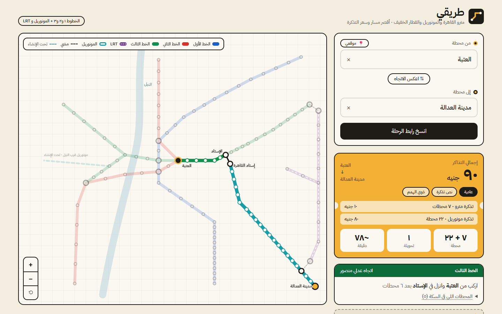

# طريقي 🚇 — مترو القاهرة والمونوريل والقطار الخفيف

[](https://github.com/elgendy2005/tareeqi/actions/workflows/ci.yml)
[](https://github.com/elgendy2005/tareeqi/actions/workflows/deploy.yml)
[](LICENSE)

### [▶ جرّب الموقع: elgendy2005.github.io/tareeqi](https://elgendy2005.github.io/tareeqi/)



<table>
  <tr>
    <td width="70%"></td>
    <td width="30%"></td>
  </tr>
  <tr>
    <td align="center">ديسكتوب: مترو + مونوريل</td>
    <td align="center">موبايل</td>
  </tr>
</table>

أداة ويب بتقولك **تركب إيه وتنزل فين وتغيّر عند مين** في مترو القاهرة، وبتحسبلك **سعر التذكرة** حسب الشرائح الرسمية الجديدة (سارية من **27 مارس 2026**).

> ده أول جزء من مشروع **طريقي** الأكبر: مرشد مواصلات عامة لمصر. بدأت بالمترو لأن بياناته معروفة ومنظمة، ومنه هبني محرك المسارات اللي هيتوسع بعد كده للميكروباص والأتوبيس.

## المميزات

- **أقصر مسار** بين أي محطتين في الخطوط 1 و2 و3 (84 محطة فريدة، بما فيها 5 محطات تبادل).
- **تحويلات ذكية**: المحرك بيفضّل رحلة فيها تحويلات أقل حتى لو أطول شوية في عدد المحطات.
- **الخط الثالث بفرعيه**: بيتفرع عند الكيت كات (روض الفرج / جامعة القاهرة). المحرك بيعرف إن الانتقال بين الفرعين معناه "غيّر القطار".
- **سعر التذكرة** و**الوقت التقريبي** وعدد المحطات.
- **القطار الكهربائي الخفيف LRT** (12 محطة شغالة): بيتربط بالمترو بمشي في عدلي منصور، وبالمونوريل بمشي في مدينة الفنون والثقافة. فرع العاشر (مدينة المعرفة) قطار مكوكي من بدر.
- **مونوريل شرق النيل** (22 محطة، من إستاد القاهرة لمدينة العدالة): بيتخطط مع المترو في نفس الرحلة. المحرك بيوضح المشي بين محطة مترو «الإستاد» ومحطة مونوريل «إستاد القاهرة»، وبيحسب كل تذكرة لوحدها لأن المونوريل ليه شرايح أسعار مختلفة.
- **خريطة تفاعلية**: تكبير بالعجلة أو القرص (pinch)، سحب، وضغطة على المحطة لاختيارها.
- **بحث ذكي بالعربي والإنجليزي**: "اوبرا" بتلاقي "الأوبرا"، و"maadi" بتلاقي "المعادي".
- **رابط قابل للمشاركة**: `?from=maadi&to=opera`.
- **نوع التذكرة**: عادية، أو نص تذكرة (كبار السن والقوات المسلحة والشرطة)، أو ذوي الهمم. السعر بيتحسب حسب الأسعار الرسمية المعلنة لكل وسيلة.
- **آخر رحلاتك**: آخر 5 رحلات بتظهر كاختصارات. بتتحفظ على جهازك بس، وتقدر تمسحها.
- **أقرب محطة ليّا**: زر «موقعي» بيحدد أقرب محطة ليك ويحطها في «من». موقعك بيتحسب على جهازك بس، ومابيتبعتش لأي سيرفر ولا بيتخزّن. لو أقرب محطة أبعد من 5 كم، مش هيختارها بالنيابة عنك.
- **بيتثبّت ويشتغل أوفلاين** (PWA): بعد أول زيارة، أي رحلة بتفتح من غير إنترنت.
- **خصوصيتك**: مفيش حسابات ولا كوكيز ولا تحليلات ولا تتبّع. كل حاجة بتتحسب في المتصفح، وأي حاجة بتتحفظ (آخر رحلاتك ونوع التذكرة) بتفضل على جهازك.
- واجهة عربية RTL بالكامل، متجاوبة مع الموبايل، وبتدعم الكيبورد وقارئ الشاشة.

## تشغيل المشروع

```bash
npm install
npm run dev      # تطوير
npm test               # اختبارات المحرك والمكوّنات (Vitest)
npm run test:coverage  # نفس الاختبارات + تغطية (أي ملف في src/lib لازم ≥ 90%)
npm run test:e2e       # Playwright على نسخة الإنتاج (أول مرة: npx playwright install chromium)
npm run build          # نسخة الإنتاج في dist/
npm run assets         # يعيد توليد الأيقونات وصورة المعاينة في public/
npm run readme-media   # يعيد توليد الـ GIF واللقطات في docs/
```

## إزاي بيشتغل

**1) نموذج البيانات** (`src/data/metro.js`): كل محطة ليها `id`. كل "خدمة" (service) هي مسار قطار من طرف لطرف: الخط 1، الخط 2، والخط 3 بنمثله كخدمتين (`3A` و`3B`) بيشتركوا في الجذع من عدلي منصور للكيت كات.

**2) المحرك** (`src/lib/router.js`): خوارزمية Dijkstra على حالات `(محطة، خدمة)`:

- التحرك لمحطة جنب = تكلفة 1.
- التحويل لخدمة تانية في نفس المحطة = تكلفة 6 (بتمثل مشي وانتظار).
- بعد ما يطلع المسار، بنقسمه لرحلات (legs) ونحسب الاتجاه والسعر والوقت.

**3) السعر**: حسب عدد المحطات من محطة الركوب لمحطة النزول، **والاتنين محسوبين** (يعني عدد الخطوات + 1):

| عدد المحطات | السعر   |
| ----------- | ------- |
| حتى 9       | 10 جنيه |
| 10 – 16     | 12 جنيه |
| 17 – 23     | 15 جنيه |
| 24 – 39     | 20 جنيه |

**4) الخريطة** (`src/data/layout.js`): خريطة تخطيطية (schematic) مش جغرافية. بنحدد نقاط ارتكاز لمحطات معينة والباقي بيتوزع بينها، وفيه اختبار بيتأكد إن محطات التبادل متطابقة الإحداثيات بين الخطوط.

## افتراضات لازم تعرفها

- عدد محطات التذكرة شامل محطة الركوب ومحطة النزول. ده حسب تصريح من شركة المترو؛ التفاصيل في [`docs/DATA.md`](docs/DATA.md).
- الوقت: معدل لكل خط محسوب من زمن الرحلة الكاملة اللي المشغّل بينشره (مثلًا الخط الأول 79 دقيقة)، + 4 دقايق تقديرية لكل تحويلة. مش جدول تشغيل حقيقي.
- الانتقال بين فرعي الخط 3 بيحتاج تغيير قطار في الكيت كات (متأكدين منه من مصدر، والتفاصيل في `docs/DATA.md`).
- أي بيان لسه مش متأكدين منه متعلّم `TODO(verify)` في [`docs/DATA.md`](docs/DATA.md).
- الـ LRT: بنفترض إن تذكرته منفصلة، وإن عد محطاته شامل الطرفين، وإن زمنه 4.8 دقيقة لكل محطة. ومدة المشي في عدلي منصور 5 دقايق، وفي الفنون والثقافة 10 دقايق. كلها افتراضات متعلّمة `TODO(verify)`.
- المونوريل: بنفترض إن تذكرته منفصلة عن المترو، وإن عد محطاته شامل الطرفين، وإن زمن الخط كله 60 دقيقة، وإن المشي في الإستاد حوالي 5 دقايق. كلها افتراضات متعلّمة `TODO(verify)` في [`docs/DATA.md`](docs/DATA.md).
- مصادر الأسعار والمحطات مكتوبة في [`docs/DATA.md`](docs/DATA.md) (آخر مراجعة: نوفمبر 2026). لو حاجة اتغيرت، عدّل `src/data/metro.js` وحدّث المصدر.

## هيكل المشروع

```
src/
  data/metro.js      المحطات والخطوط والأسعار
  data/layout.js     إحداثيات الخريطة التخطيطية
  data/coords.js     إحداثيات جغرافية حقيقية (OpenStreetMap)
  data/data.test.js  اختبارات سلامة البيانات
  lib/router.js      محرك المسارات (Dijkstra) + حساب السعر
  lib/search.js      توحيد وبحث النصوص العربية
  lib/geo.js         مسافات جغرافية (Haversine)
  lib/router.test.js اختبارات (Vitest)
  lib/format.js      صياغة الأرقام والجمل (وملخص قارئ الشاشة)
  components/        StationPicker · MetroMap · RouteResult (+ اختبارات Testing Library)
e2e/                 اختبارات Playwright على نسخة الإنتاج (المسارات، الأوفلاين، SEO)
scripts/             توليد الأيقونات وصورة المعاينة وصور الـ README
docs/DATA.md         مصدر كل بيان + تاريخ المراجعة
docs/CASE_STUDY.md   دراسة حالة: المشكلة والقرارات والـ trade-offs
```

## النشر على GitHub Pages

1. ارفع المشروع على repo.
2. من **Settings → Pages** اختار **Source: GitHub Actions**.
3. أي push على `main` هيشغّل `.github/workflows/deploy.yml` وينشر الموقع تلقائي.

## الخطوات الجاية

- [x] **أقرب محطة ليّا** باستخدام Geolocation.
- [x] إضافة **مونوريل شرق النيل**.
- [x] **القطار الكهربائي الخفيف LRT** (المحطات الـ 12 الشغالة).
- [ ] مونوريل غرب النيل ومحطات LRT الجديدة (لما يتشغّلوا رسميًا).
- [ ] طبقة **الميكروباص** بمساهمات المستخدمين (Crowdsourcing).
- [x] PWA بتشتغل أوفلاين.

## التقنيات

React 18 · Vite · Tailwind CSS v4 · vite-plugin-pwa · Vitest + Testing Library · Playwright · IBM Plex Sans Arabic (self-hosted)

## الترخيص

الكود: MIT.

الإحداثيات الجغرافية للمحطات (`src/data/coords.js`): © [OpenStreetMap contributors](https://www.openstreetmap.org/copyright)، مرخّصة بـ ODbL 1.0.
